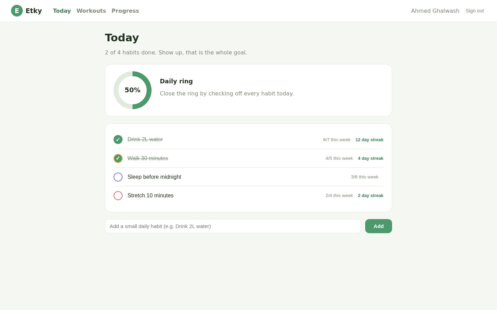
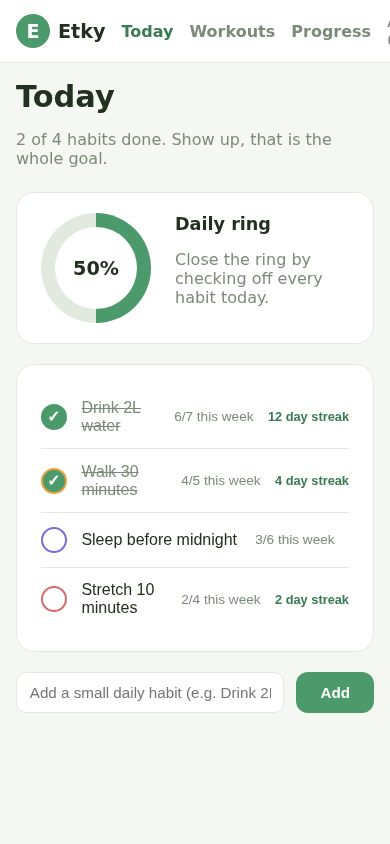
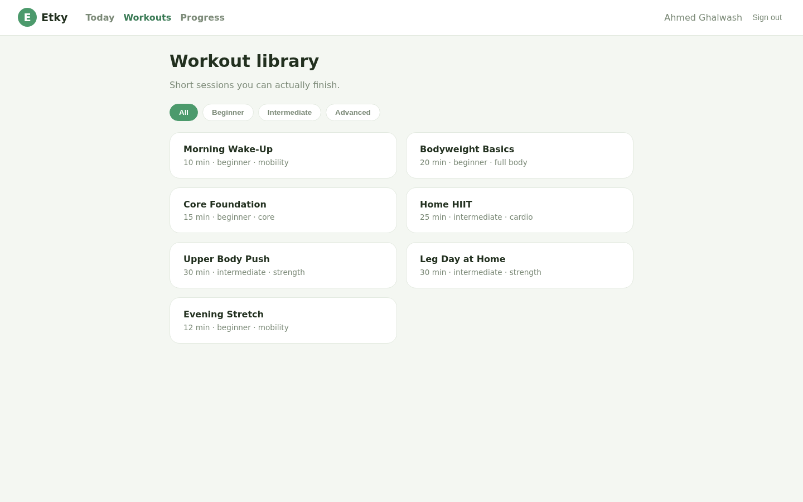
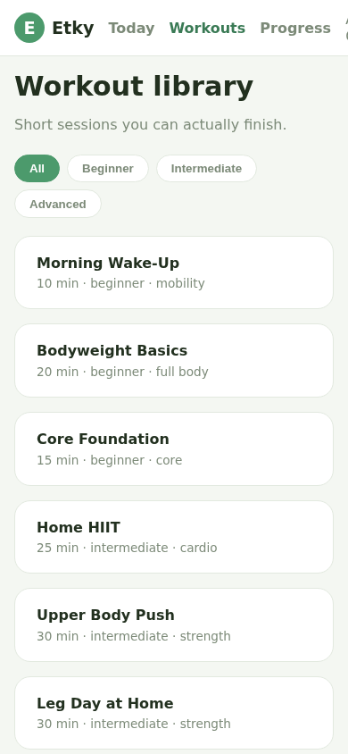
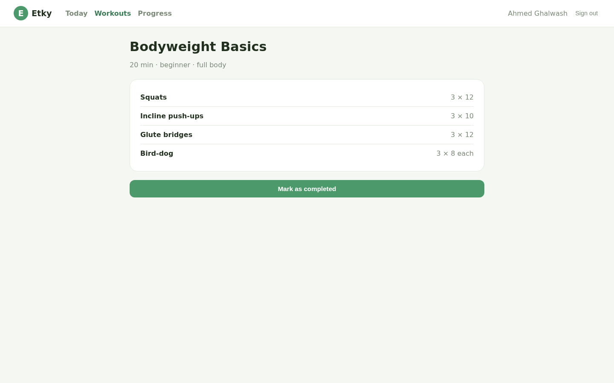
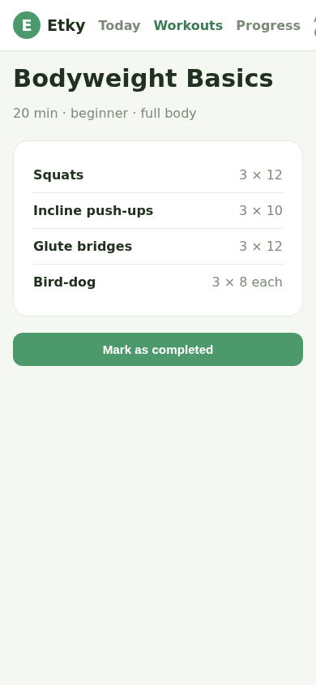
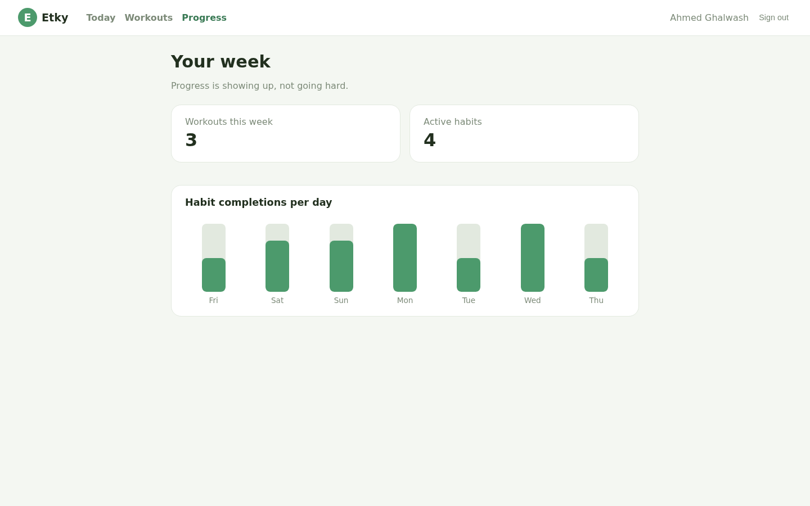

# Etky - Fitness & Habit Tracker

A gentle habit-building fitness app focused on consistency over intensity.

Full-stack concept application: a **React 18** single-page client, a **PHP 8 REST API**
(framework-free, PDO with prepared statements) and a **MySQL** database.

## Features

- Daily habit check-offs with idempotent toggle (unique constraint per habit per day)
- Automatic streak and weekly-count calculation
- Workout library with levels, categories and exercise lists
- Workout completion logging and a weekly progress summary

## Tech stack

| Layer | Tech |
| --- | --- |
| Front end | React 18, Vite, React Router |
| Back end | PHP 8.1+, PDO (native prepared statements), PHP sessions |
| Database | MySQL 8 (InnoDB, foreign keys, transactions) |

## Screenshots

| Screen | Desktop | Mobile |
| --- | --- | --- |
| Daily habit ring and check-offs |  |  |
| Workout library |  |  |
| Workout detail with exercises |  |  |
| Weekly progress |  |  |

## Source code

The full source code for this project - the React client, the PHP REST API, and the
database schema with seed data - is kept in a **private repository**.

It is available on request: reach out through my
[GitHub profile](https://github.com/ahmed-ghalwash) and I will be happy to share it.
